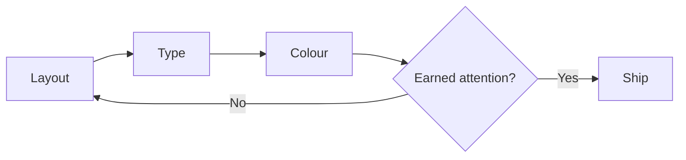

# A quiet interface is an opinionated one

Quiet interfaces are often mistaken for unfinished ones. In practice they are the most
opinionated work in a product: every removed element is a decision someone has to defend.

## Quiet is a budget, not a style

Treat attention as a finite budget you spend on the user's behalf.

- A colour that appears everywhere communicates nothing.
- A border that separates everything separates nothing.
- A heading that shouts at every level leaves nowhere to escalate to.

> [!IMPORTANT]
> Hierarchy is arithmetic. Every emphasis you add devalues the emphasis already there.

## Three passes

We design every surface in three passes, in order.

1. **Layout.** Block the page in grey boxes until the reading order is obvious in a
   thumbnail.
2. **Type.** Set the scale, then delete one size. If the page survives, the size was not
   carrying anything.
3. **Colour.** Add one accent. Only then ask whether a second is truly needed.

## The test that matters

Read the page in grayscale. If the hierarchy still works, colour is decoration and can be
argued about freely. If it collapses, colour was doing a job that structure should have been
doing all along.

  
What about dark mode specifically?

  
Dark mode removes the crutch of white space as contrast. Depth has to come from light instead: a single ambient glow, one elevated surface, and type weights that move in small steps. It punishes any interface that was relying on a grey border to explain itself.

---

[Next: craft notes from the studio](/posts/craft-notes-three-passes)
