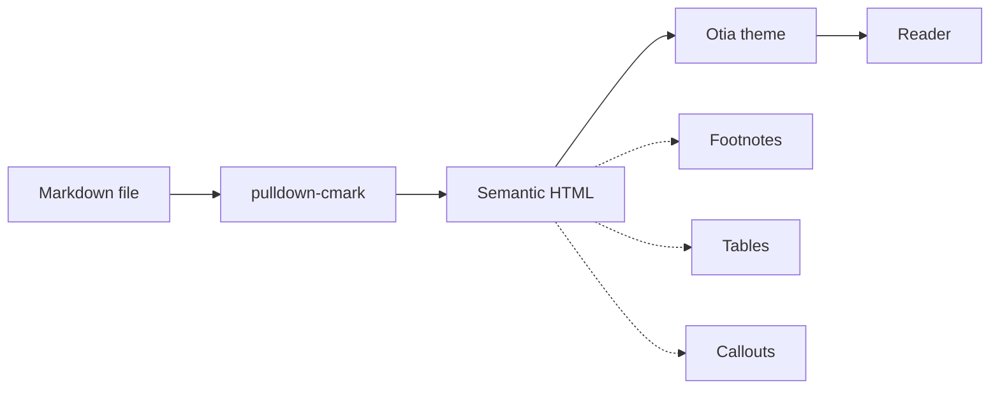
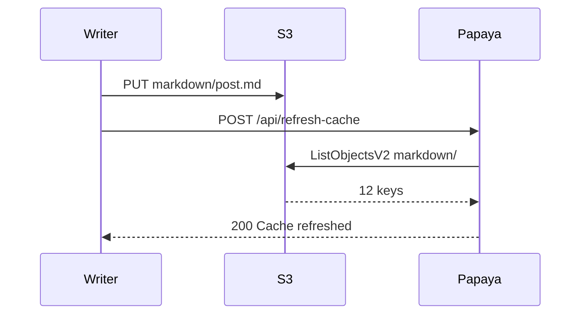
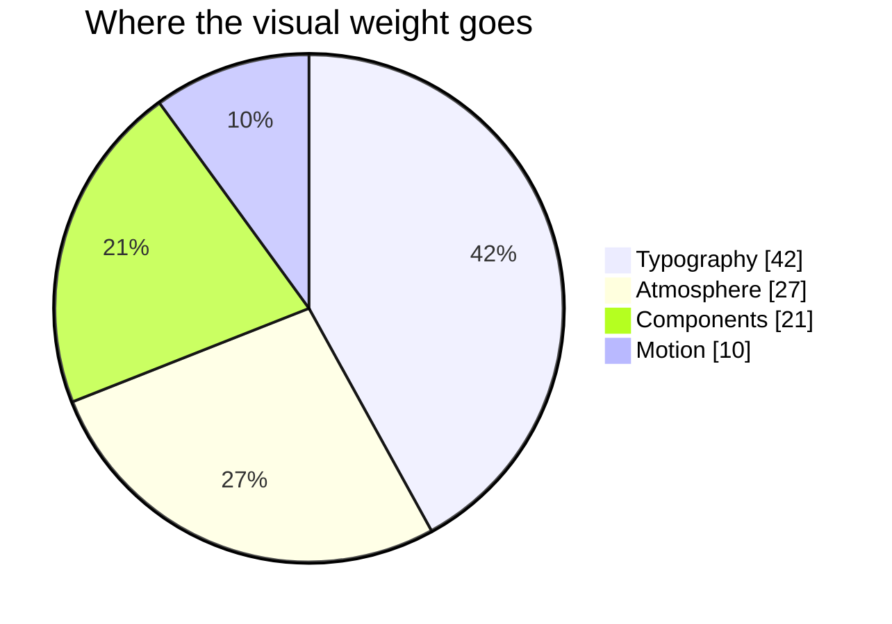
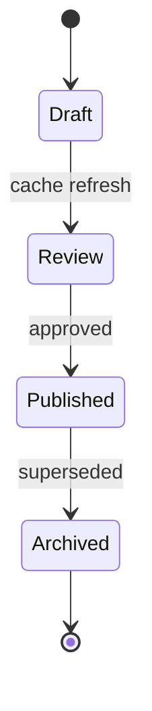

# The Otia design system

Every surface Otia ships starts from the same premise: **the canvas should be quiet so the
work can be loud**. This entry is the theme's own test fixture — it exercises every
Markdown element the renderer can produce, and shows how each one is treated.

If you are reading this on a Papaya CMS deployment with the `otia` theme loaded, then all of
the following was generated from a single `.md` file: no page builder, no shortcode plugin,
no client-side framework.

## A short, opinionated primer

The system has four rules.

1. **Near-black, never pure black.** `#050505` with a mid-tone ellipse keeps edges soft.
2. **Playfair for voice, Source Serif for reading.** Display type carries emotion, body type carries attention.
3. **One accent, used sparingly.** A desaturated sage that only appears on the things you can act on.
4. **Motion is a whisper.** Fades and 14-pixel rises, nothing that makes you wait.

> "Restraint is the loudest design decision you can make. Everything else is decoration."
> <cite>Otia studio notes</cite>

### Typography at every level

The heading scale is tuned per level rather than per page. Display serif for the large
voices, letterspaced small caps for the quiet ones.

#### Fourth-level headings stay in the display family

They are the last size where the serif still reads as a title.

##### Fifth-level headings switch to letterspaced caps

##### They behave like labels inside a document

###### And so does the sixth level

A paragraph can carry `inline code`, **bold emphasis**, *italic nuance*, ~~deleted text~~,
<mark>a highlighted phrase</mark>, a keyboard hint such as <kbd>⌘</kbd> <kbd>K</kbd>, and an
abbreviation such as <abbr title="Cascading Style Sheets">CSS</abbr>. Otia also enables smart
punctuation, so straight quotes become typographic -- like this -- and ellipses become an
ellipsis character...

Links look like [this one to the Papaya CMS repository](https://github.com/aseemsavio/papaya-cms)
and quietly brighten on hover.

## Callouts

Blockquotes that begin with a GitHub-style marker become typed callouts. Each type gets its
own accent and a small luminous dot.

> [!NOTE]
> Notes are for context you want a reader to keep in mind while skimming.

> [!TIP]
> Tips are for the shortcut. The thing that saves someone ten minutes.

> [!IMPORTANT]
> Everything important should be rare. If a document has five important callouts, it has none.

> [!WARNING]
> Warnings are for the moment before something breaks: destructive commands, breaking changes, expiring credentials.

> [!CAUTION]
> Caution is for the irreversible. Treat it as a speed bump, not a wall.

## Tables

The table treatment is a rounded glass slab: hairline borders, a sage-tinted header row with
letterspaced caps, tabular numerals, zebra rows, and a hover that lifts the first column into
the accent colour.

| Token | Value | Role | Contrast |
| :--- | :---: | :--- | ---: |
| `--bg` | `#050505` | Page canvas | 19.4:1 |
| `--bg-mid` | `#0a0c0e` | Ambient core | 17.9:1 |
| `--ink` | `#f5f5f4` | Primary text | 18.9:1 |
| `--sage` | `#8cb4aa` | Action accent | 7.1:1 |
| `--mint` | `#a7f3d0` | Links, focus | 12.6:1 |
| `--lime` | `#b4e650` | Signals only | 13.4:1 |
| `--faint` | `rgba(245,245,244,.36)` | Captions, meta | 3.2:1 |

A shorter table with an emphatic middle column:

| Surface | Behaviour |
| :--- | :---: |
| Journal index | Rows lift, cover desaturates back to colour |
| Post page | Reading progress line, 46rem measure |
| Code | Language label, copy button, custom token palette |
| Carousel | Drag, arrows, dots, counter, autoplay on idle |

## Code

Fenced code blocks are framed with a hairline header showing the language and a copy button.
Syntax colours come from one narrow palette so a page never looks like a fruit salad.

```rust
// Papaya turns Markdown into HTML, the theme turns HTML into a reading experience.
use pulldown_cmark::{html, Options, Parser};

pub fn render(markdown: &str) -> String {
    let mut options = Options::empty();
    options.insert(Options::ENABLE_TABLES);
    options.insert(Options::ENABLE_FOOTNOTES);
    options.insert(Options::ENABLE_TASKLISTS);
    options.insert(Options::ENABLE_STRIKETHROUGH);

    let parser = Parser::new_ext(markdown, options);
    let mut out = String::new();
    html::push_html(&mut out, parser);
    out
}
```

```javascript
// The carousel is dependency-free: one transform, one pointer, one interval.
const go = (next) => {
  index = (next + slides.length) % slides.length;
  track.style.transform = `translateX(${-100 * index}%)`;
  counter.textContent = `${pad(index + 1)} / ${pad(slides.length)}`;
};
```

```bash
# Publish content and refresh the in-memory cache.
aws s3 cp ./post.md s3://papaya/markdown/post.md \
  --endpoint-url http://localhost:9000

curl -X POST http://localhost:8080/api/refresh-cache \
  -H "Authorization: Bearer $PAPAYA_REFRESH_TOKEN"
```

```json
{
  "post": {
    "slug": "otia-design-system",
    "tags": ["design", "typography", "themes"],
    "reading_minutes": 9
  }
}
```

```yaml
theme:
  name: otia
  mode: dark
  fonts:
    display: Playfair Display
    body: Source Serif 4
    mono: JetBrains Mono
  accents:
    sage: "#8cb4aa"
    mint: "#a7f3d0"
```

```toml
[site]
name = "Otia"
description = "Product studio for apps and SaaS."
base_url = "https://getotia.com"

[server]
host = "0.0.0.0"
port = 8080
```

```sql
select theme, count(*) as posts
from journal_entries
where published = true
group by theme
order by posts desc;
```

```diff
- .prose blockquote::before { content: '"'; }
+ .prose .callout::before { content: none; }
```

## Diagrams

Fenced `mermaid` blocks are hydrated into themed SVG. The palette is inherited from the same
tokens as the rest of the page, so diagrams never fight the canvas.









## Images and figures

A lone image gets the full measure, a hairline ring, and a deep soft shadow. Clicking one
opens a lightbox; pressing <kbd>Esc</kbd> closes it.


Raw HTML lets you attach a caption when it matters:

<figure>
  
  <figcaption>Orbit — one ring, one signal colour, nothing else competing for attention.</figcaption>
</figure>

## Carousels

Two authoring paths produce the same component. The fenced form is the most portable:

```carousel
/assets/images/otia-aurora.svg | Aurora — soft gradients over near-black
/assets/images/otia-tide.svg | Tide — concentric arcs in sage
/assets/images/otia-dunes.svg | Dunes — warm sand against cold steel
/assets/images/otia-orbit.svg | Orbit — a single ring of light
```

The HTML form works too, which means galleries written for other themes keep working:

<div class="gallery">
  
  
  
</div>

## Lists

Unordered lists use sage markers; ordered lists use tabular monospace numerals.

- Atmosphere first: background, glow, grain.
- Type second: display scale, then reading scale.
- Components third: tables, code, callouts, carousels.
- Motion last, and only if it survives a `prefers-reduced-motion` audit.

1. Write the entry in Markdown.
2. Upload it to the `markdown/` prefix.
3. Refresh the cache.
4. Read it out loud once, then publish.

Nested lists keep their rhythm:

- Surfaces
  - Journal index
  - Post page
  - Empty state
- Components
  - Inline: `code`, <kbd>kbd</kbd>, <mark>mark</mark>
  - Block: tables, code, quotes, callouts

Task lists render as real checkboxes:

- [x] Dark canvas with ambient glow and grain
- [x] Reading progress and scroll reveal
- [x] Callouts, carousels, diagrams, lightbox
- [ ] Comments (deliberately out of scope)
- [ ] Search (a separate build)

## Description lists

<dl>
  <dt>Measure</dt>
  <dd>46rem for prose, 68rem for indexes. Wide enough to breathe, narrow enough to track.</dd>
  <dt>Rhythm</dt>
  <dd>1.8 line height on a 1.16rem body — roughly 68 characters per line on desktop.</dd>
  <dt>Accent budget</dt>
  <dd>One sage hue, one mint for interaction, one lime reserved for signals.</dd>
</dl>

## Disclosure

<details>
  <summary>Why near-black instead of pure black?</summary>
  <p>Pure black at full screen can cause halation with light text and crushes soft shadows on OLED panels. A five-percent lift keeps the page cinematic while holding contrast ratios well above AA.</p>
</details>

<details>
  <summary>Why Playfair Display for headings?</summary>
  <p>It has a high-contrast, editorial voice that reads as a publication rather than a dashboard. Paired with a calmer body serif, it gives long-form writing a sense of occasion without slowing the reader down.</p>
</details>

## Footnotes and references

The system keeps footnotes at the end of the document, typed at a smaller size with sage
labels[^order]. Nothing interrupts the flow of a paragraph[^inline] and nothing demands a
second scroll position[^cost].

[^order]: Definitions are grouped into a single "Notes" section by the runtime, so the reader sees one boundary instead of many.
[^inline]: The reference marker is a monospace chip rather than a superscript number, which survives smaller type sizes better.
[^cost]: The trade-off is that the footnote text is further away from its marker than in print. For engineering and design notes, that is the correct trade.

---

## Composition checklist

When adding a new entry, this is the whole ritual:

- [ ] Frontmatter with `title`, `slug`, `date`, `summary`, `tags`, and a `cover_image`.
- [ ] One clear idea, stated in the first three paragraphs.
- [ ] A diagram wherever prose would take a paragraph to explain a relationship.
- [ ] Code that someone could paste and run.
- [ ] A summary short enough to read in the index without clicking.

> The best test of a theme is boring: drop a genuinely messy document into it and see whether
> anything falls over. If a table, a diagram, a carousel and three footnotes can coexist on one
> page without shouting, the system is doing its job.
