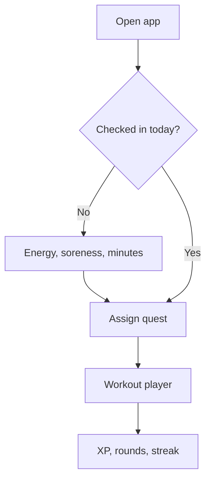

# Shipping Cindy Routine without a growth team

Cindy Routine exists because one workout is enough. Five pull-ups, ten push-ups, fifteen
squats, for as many rounds as possible in twenty minutes. The app's entire job is to make
that loop survivable for someone who cannot yet do the first round.

## What we cut

Everything that needed a team to operate.

- **No social feed.** Comparisons are the fastest way to lose a beginner.
- **No live coach.** Rules are honest; a chatbot pretending to be one is not.
- **No HealthKit in v1.** It is a dependency with a permission prompt and no upside on day one.
- **No desktop.** The workout happens on a phone, on a floor, with sweaty hands.

> [!TIP]
> If a feature needs a human to keep running, it is not a feature. It is a job.

## What we kept

| Decision | Why it stayed |
| :--- | :--- |
| Daily check-in | Energy and soreness change the day's quest, so the plan feels earned |
| Movement ladders | A beginner needs a rung, not a target |
| Guided player | Reps, rounds, and form cues in the same place as the timer |
| Streaks with a rule | Miss twice and the grid resets — generous, but not infinite |

## The onboarding bet

The first screen asks how you feel, not who you are. Goals and training history come after,
because the app cannot programme a session until it knows today's constraints.

## Three things we would tell our past selves

1. Ship the check-in before the streak grid. Habit beats gamification.
2. Write the empty states first. They are the screens a new user actually sees.
3. Keep one accent colour. Two accents and the interface starts arguing with itself.

---

Follow along at [getotia.com](https://getotia.com).
